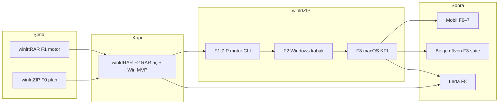

# winlrt suite — birleşik yol haritası

**Operasyon:** `main` dalına merge → GitHub Actions vitrin deploy ([AUTO_DEPLOY.md](./AUTO_DEPLOY.md)).  
**Kod:** Tek monorepo; ortak motor, ayrı ürün kabukları.

## Vizyon (kısa)

| Katman | Açıklama |
|--------|----------|
| **winlrt.com.tr** | Yerli arşiv, belge, sertifika ailesi — kurumsal + bireysel |
| **lerta.com.tr** | Mesaj / posta (ayrı ürün); olgun winlrt modülleri **Faz 8** entegrasyonu |

## Ürün sırası (onaylı)



## Detay dokümanlar

| Ürün | Plan | Faz 0 |
|------|------|--------|
| winlrtRAR | [WINLRTRAR_PLAN.md](./WINLRTRAR_PLAN.md) | [WINLRTRAR_PHASE0.md](./WINLRTRAR_PHASE0.md) (kapalı) |
| winlrtZIP | [WINLRTZIP_PLAN.md](./WINLRTZIP_PLAN.md) | [WINLRTZIP_PHASE0.md](./WINLRTZIP_PHASE0.md) (açık) |

## Ortak KPI (P0 × 3)

1. **Hız** — benchmark CI  
2. **Sıkıştırma oranı** — `.wlrt` ve ZIP satırları  
3. **Kurumsal güven** — AES-256-GCM, Argon2id, denetim, imzalı kurulum  

Pilot: **banka, sendika, KOBİ**.

## Repo yapısı (hedef)

```text
apps/web/                 # winlrt.com.tr vitrin
apps/winlrt-rar/          # Faz 2+
apps/winlrt-zip/          # ZIP F2+
crates/winlrt-archive/      # Ortak motor (aktif)
benchmarks/
docs/                     # Planlar
.github/workflows/        # CI + deploy
```

## Vitrin faz özeti (kullanıcıya dönük)

| Adım | İçerik |
|------|--------|
| 1 | **winlrtRAR** motor + masaüstü; **winlrtZIP** planlı, RAR F2 sonrası hızlanır |
| 2 | Mobil mağazalar |
| 3 | PDF, imza, sertifika |
| 4 | Lerta üretim entegrasyonu |

Genel özet: [PRODUCT_ROADMAP.md](./PRODUCT_ROADMAP.md)
