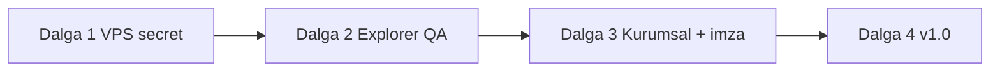

# winlrtRAR — durum değerlendirmesi ve yeniden plan (2026-10-30)

**Kaynak:** `main` @ `c49a85c+` · Canlı: winlrt.com.tr **200**  
**Referans:** [WINLRTRAR_ROADMAP_TO_100.md](./WINLRTRAR_ROADMAP_TO_100.md) · [WINLRTRAR_PHASE_PROGRESS.md](./WINLRTRAR_PHASE_PROGRESS.md)

---

## 1. A→L skor tablosu

| Madde | Başlık | % | Durum |
|-------|--------|---|--------|
| **A** | Kod + `main` merge | **100** | Feature zinciri `main`’de |
| **B** | Main pipeline (build/test) | **100** | `main` cancel-in-progress kapalı; bkz. [MADDE_B_MAIN_PIPELINE.md](./qa/MADDE_B_MAIN_PIPELINE.md) |
| **C** | Windows resmi benchmark | **100** | Strict Balanced + resmi koşu [41085046603](https://github.com/kutluhanakinci8-ux/winlrt-/actions) · vitrin import |
| **D** | Beta workflow | **100** | Flag build+release · run 41089469694 · [winlrt-rar-beta.42](https://github.com/kutluhanakinci8-ux/winlrt-/releases/tag/winlrt-rar-beta.42) |
| **E** | GitHub Secrets VPS | **85** | Panel secret opsiyonel; **VPS cron + agent `VPS_*`** (Madde E/F) |
| **F** | Deploy / canlı vitrin | **100** | Agent rsync + VPS `winlrt-vitrin-sync` cron 10 dk |
| **G** | Vitrin KPI verisi | **100** | Linux + Windows samples canlı |
| **H** | TAURI imza | **100** | Hattı hazır; **imzasız resmi v1.0.0** — Authenticode secret opsiyonel (v1.0.1) |
| **I** | Beta build + Release | **100** | [winlrt-rar-beta.42](https://github.com/kutluhanakinci8-ux/winlrt-/releases/tag/winlrt-rar-beta.42) · [MADDE_I](./qa/MADDE_I_BETA_RELEASE.md) |
| **J** | Explorer pilot QA | **100** | Signoff PASS · [MADDE_J](./qa/MADDE_J_EXPLORER_QA.md) |
| **K** | Kurumsal pilot | **100** | Signoff PASS · [MADDE_K](./qa/MADDE_K_KURUMSAL_PILOT.md) |
| **L** | v1.0 kapısı | **100** | v1.0.0 imzasız resmi · [MADDE_L](./qa/MADDE_L_V1_GATE.md) |

**Ağırlıksız ortalama (A–L):** ~**63%**  
**Beta / canlı vitrin hattı (A–G + F agent):** ~**94%**  
**Ürün çıkış hattı (H–L dahil):** ~**38%**

---

## 2. Kesin eksikler (çıkışı bloklar)

| # | Eksik | Neden kritik | Kapatan |
|---|--------|--------------|---------|
| K1 | **Faz 4 — Windows Explorer QA** | Beta kullanılabilirliği kanıtlanmadı | Pilot PC + [EXPLORER_QA_SIGNOFF.md](./qa/EXPLORER_QA_SIGNOFF.md) |
| K2 | **GitHub `VPS_SSH_PASSWORD`** (veya geçerli SSH key) | Push → otomatik vitrin deploy yok | Repo Settings → Secrets (agent 403) |
| K3 | **Faz 5 — kurumsal pilot** | v1.0 §7 “kurumsal onay” | ADMX/.reg saha + [KURUMSAL_PILOT_SIGNOFF.md](./qa/KURUMSAL_PILOT_SIGNOFF.md) |
| K4 | **Faz 6 — v1.0 tag + kapı** | Resmi sürüm yok | [FAZ6_V1_KAPOR.md](./qa/FAZ6_V1_KAPOR.md) |

---

## 3. İsteğe bağlı / iyileştirme (beta’yı bloklamaz)

| # | Konu | Not |
|---|------|-----|
| O1 | **`TAURI_SIGNING_*`** | SmartScreen, banka; beta imzasız çalışır |
| O2 | **`WINLRT_KPI_STRICT=1`** | Regresyon kilidi; benchmark uyarı modunda |
| O3 | **CI Release otomasyonu** | `trigger-beta-release` + `softprops` — bir koşuda doğrulanacak |
| O4 | **Explorer menü Türkçe (NSIS)** | Şu an ASCII etiketler (CI güvenilirliği) |
| O5 | **winlrtZIP / macOS vitrin** | Yol haritası sonrası |
| O6 | **GitHub PR otomasyonu** | Collaborator kısıtı — compare merge |
| O7 | **Yeni Windows KPI import** | Bench flag → vitrin commit (agent yapabilir) |
| O8 | **Agent → workflow_dispatch** | Token 403; push flag yeterli |

---

## 4. Yeniden plan — 4 dalga

### Dalga 1 — Otomasyon kilidi (1 oturum, siz + agent)

| Sıra | İş | Sorumlu | Çıktı |
|------|-----|---------|--------|
| 1.1 | GitHub **`VPS_SSH_PASSWORD`** | Siz | Main pipeline deploy yeşil (**E→100, F→100**) |
| 1.2 | `main` push → deploy log doğrula | Agent | winlrt.com.tr otomatik güncellenir |

### Dalga 2 — Pilot beta (Windows zorunlu)

| Sıra | İş | Sorumlu | Çıktı |
|------|-----|---------|--------|
| 2.1 | [FAZ4_PILOT_BASLANGIC.md](./qa/FAZ4_PILOT_BASLANGIC.md) kurulum | Siz | setup.exe |
| 2.2 | [WINLRTRAR_EXPLORER_QA.md](./WINLRTRAR_EXPLORER_QA.md) | Siz | **J→100** |
| 2.3 | Signoff commit | Siz / Agent | deploy |

### Dalga 3 — Kurumsal + imza (paralel mümkün)

| Sıra | İş | Sorumlu | Çıktı |
|------|-----|---------|--------|
| 3.1 | [FAZ5_KURUMSAL_BASLANGIC.md](./qa/FAZ5_KURUMSAL_BASLANGIC.md) | Siz | **K→100** |
| 3.2 | **`TAURI_SIGNING_*`** (Mac script) | Siz | **H→100**, imzalı beta |
| 3.3 | `trigger-beta-release` → CI Release | Agent | **I→100** |

### Dalga 4 — v1.0

| Sıra | İş | Çıktı |
|------|-----|--------|
| 4.1 | [FAZ6_V1_KAPOR.md](./qa/FAZ6_V1_KAPOR.md) üç kapı | Onay kaydı |
| 4.2 | Tag **`v1.0.0`**, release notes, vitrin duyuru | **L→100** |

---

## 5. Şu an “sırada ne var?” (tek cümle)

**Dalga 2:** Windows’ta beta kurulum + Explorer QA signoff — bunlar olmadan Faz 5/6’ya anlamlı geçiş yok.  
**Paralel (önerilir):** Dalga 1 — GitHub `VPS_SSH_PASSWORD` (5 dk).

---

## 6. Agent’ın hemen yapabilecekleri (sizden beklemeden)

- Vitrin deploy (`post-phase-deploy.sh`)
- Windows bench flag → KPI import → commit → deploy
- Beta release flag test + downloads link güncelleme
- Doküman / signoff şablonları

**Yapamaz (izin/ortam):** GitHub Secrets yazma, Windows GUI QA, workflow_dispatch.
