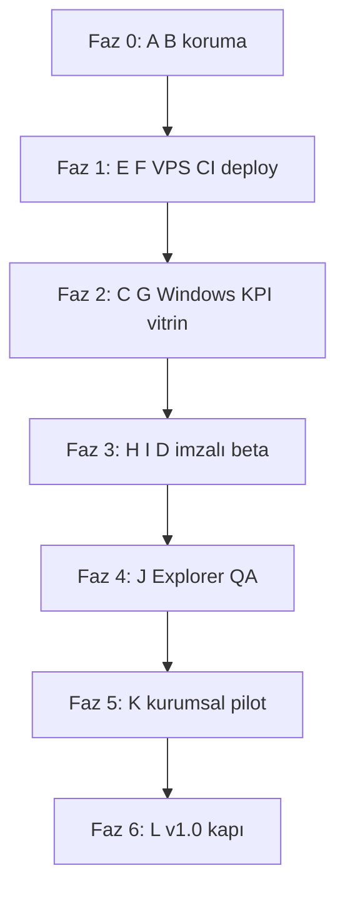

# Lertiva Arc — A→L yol haritası (%100 tamamlanma)

Bu plan, durum tablosundaki **A–L** maddelerini **sırayla %100**’e çıkarmak içindir.  
Bağımlılıklar yukarıdan aşağıya: önce **E→F** (otomatik deploy), sonra **C→G** (resmi KPI vitrin), sonra **H→I** (imzalı beta), sonra **J→K→L** (saha + v1.0 kapısı).

**A** ve **B** zaten %100 — yalnızca regresyon korunur (her `main` push’ta Main pipeline yeşil kalmalı).

| Madde | Hedef % | Bu plandaki faz |
|-------|---------|-----------------|
| A Kod + main | 100 | — (koruma) |
| B Main pipeline CI | 100 | — (koruma) |
| C Windows resmi benchmark | 100 | Faz 2 |
| D Beta workflow hazırlığı | 100 | Faz 3 (dispatch + yeşil koşu) |
| E GitHub Secrets VPS | 100 | Faz 1 |
| F Deploy / canlı vitrin | 100 | Faz 1 + Faz 2 |
| G Vitrin KPI verisi | 100 | Faz 2 |
| H TAURI imza secrets | 100 | Faz 3 |
| I Beta build + Release | 100 | Faz 3 |
| J Explorer pilot QA | 100 | Faz 4 |
| K Kurumsal pilot | 100 | Faz 5 |
| L v1.0 kapısı | 100 | Faz 6 |

---

## Faz 0 — Referans (tamamlandı, koruma)

**Kapsam:** A %100, B %100  
**Amaç:** Gerileme olmadan ilerlemek.

| Adım | Kim | Kabul (%100) |
|------|-----|----------------|
| Feature zinciri `main`’de kalsın | Siz / Agent | Compare gerektirmeden geliştirme `main` veya PR merge |
| Her anlamlı push sonrası **Main pipeline** success | CI | web job + rust job yeşil |
| Deploy job | CI | Faz 1 bitene kadar manuel rsync kabul; Faz 1 sonrası deploy job da yeşil + rsync log |

**Regresyon:** rust test, `mixed/prepare`, vitrin build kırılırsa önce düzelt, sonra sonraki faz.

---

## Faz 1 — Otomatik deploy (E %100, F %100)

**Bağımlılık:** Yok (manuel deploy zaten yapıldı; bu faz CI’yı eşler).  
**Süre:** Tek oturum (secret + bir pipeline koşusu).

### 1.1 GitHub Secrets — VPS (E → %100)

Repo: **Settings → Secrets and variables → Actions**

| Secret | Değer (örnek) | Not |
|--------|----------------|-----|
| `VPS_HOST` | `37.230.105.99` veya `srv.winlrt.com.tr` | |
| `VPS_PORT` | `23422` | |
| `VPS_USER` | `root` | |
| `VPS_WEB_ROOT` | `/var/www/winlrt/apps/web/dist` | |
| **Kimlik (biri zorunlu)** | | |
| `VPS_SSH_PASSWORD` | root SSH şifresi | **Önerilen** (bozuk key sorununu bypass) |
| veya `VPS_SSH_KEY_B64` | tek satır base64 | Mac: `scripts/mac-vps-key-base64-for-github.sh` |
| veya `VPS_SSH_KEY` | OpenSSH private key | Mac: `scripts/mac-set-github-vps-secret.sh` |

**Temizlik (E güvenlik):** Eski/bozuk `VPS_SSH_KEY` secret’ını silin veya düzeltin; yalnızca password **veya** tek geçerli key kalsın.

**Kabul (E %100):** Secret listesinde host/port/user/web_root + geçerli auth; Main pipeline deploy adımında `auth=password` veya `auth=key`, **asla `auth=skip` değil**.

### 1.2 CI deploy doğrulama (F → %100)

| Adım | Kim | Kabul |
|------|-----|--------|
| Actions → **Main pipeline** → Run workflow (`main`) veya boş commit push | Siz / Agent | Job **Deploy** yeşil |
| Log: **Deploy dist to VPS** + **Reload nginx** | CI | rsync satırları, hata yok |
| `https://winlrt.com.tr/` HTTP 200 | Siz | |
| VPS’te `dist` mtime / içerik push SHA ile uyumlu | İsteğe | |

**Alternatif (F geçici):** `bash scripts/agent-deploy-vitrin.sh` — yalnızca acil; **F %100** için CI deploy şart.

**F %100 tanımı:** Her `main` push otomatik vitrin günceller; manuel rsync yedek plan.

---

## Faz 2 — Resmi Windows KPI + vitrin verisi (C %100, G %100)

**Bağımlılık:** Faz 1 (deploy commit’leri otomatik gider).  
**C ve G birlikte kapanır.**

### 2.1 Windows resmi benchmark — resmi kanıt (C → %100)

| Adım | Kim | Kabul |
|------|-----|--------|
| Actions → **winlrt Windows benchmark (resmi)** → Run workflow | Siz | Job success |
| İsteğe: **KPI strict** açık veya repo Variable `WINLRT_KPI_STRICT=1` | Siz | Strict açıksa KPI fail = job fail (kapı “kilitli”) |
| Artifact **bench-report-windows** indir | Siz / Agent | İçinde balanced + fast JSON |
| Log: `evaluate-bench-kpi.ps1` özeti; `compression_gate` / `speed_gate` | CI | Strict kapalıysa uyarı OK; strict açıksa geçmeli |
| (İsteğe) Variable `WINLRT_KPI_STRICT=1` kalıcı | Siz | Gelecek release’lerde regresyon kapısı |

**C %100 tanımı:** En az bir **manuel resmi** koşu yeşil + artifact arşivde + log/artifact ile KPI özeti doğrulanmış (+ isteğe strict policy kararı yazılı).

### 2.2 Vitrin KPI import (G → %100)

```bash
# Artifact’tan çıkarılan dosya yollarıyla:
bash scripts/import-windows-kpi-to-vitrin.sh \
  ./bench-report-windows.json \
  ./bench-report-windows-fast.json
git add apps/web/public/benchmark/samples/windows-*.json
git commit -m "chore(vitrin): Windows resmi KPI samples"
git push origin main
```

| Adım | Kabul |
|------|--------|
| Repo’da `windows-balanced-kpi.json`, `windows-fast-kpi.json` | Var |
| Main pipeline + deploy | Canlı `/benchmark/samples/windows-*.json` 200 |
| Vitrin sayfası Linux + Windows kartları | winlrt.com.tr/benchmark |

**G %100 tanımı:** Canlı vitrinde **Linux + Windows** resmi sample JSON; kaynak `windows-official-ci`.

---

## Faz 3 — İmzalı beta dağıtım (D %100, H %100, I %100)

**Bağımlılık:** Faz 2 (KPI hikâyesi vitrinde; beta duyurusu tutarlı).

### 3.1 TAURI imza secrets (H → %100)

Mac / güvenli ortam: [WINLRTRAR_CODE_SIGNING.md](./WINLRTRAR_CODE_SIGNING.md), `scripts/mac-set-github-tauri-signing-secrets.sh`

| Secret | Amaç |
|--------|------|
| `TAURI_SIGNING_PRIVATE_KEY` | Tauri updater / Authenticode zinciri |
| `TAURI_SIGNING_PRIVATE_KEY_PASSWORD` | Anahtar parolası |

**Kabul (H %100):** Secrets tanımlı; beta workflow’da “imza secret yok” uyarısı **çıkmaz**.

### 3.2 Lertiva Arc Windows beta build (D + I → %100)

| Sıra | Adım | Kabul |
|------|------|--------|
| 1 | Actions → **Lertiva Arc Windows beta build** → `skip_release=true` (ilk duman) | Artifact **winlrt-rar-windows-bundle** |
| 2 | Log: **Verify Authenticode** geçer | İmza doğrulandı |
| 3 | Aynı workflow `skip_release=false` | GitHub Release `winlrt-rar-beta.<run>` |
| 4 | `/downloads/` veya vitrin linki Release URL ile güncel (commit gerekirse) | Pilot indirebilir |

**D %100 tanımı:** Workflow en az bir kez **bilinçli dispatch** ile uçtan uca yeşil (artifact veya release).

**I %100 tanımı:** İmzalı kurulum **Release veya artifact** olarak indirilebilir; imza verify CI’da geçmiş.

**Not:** Push’ta görünen `lertiva-arc-windows.yml` 0s kayıtları **dispatch-only** workflow için gürültü; kabul kriteri **manuel run success**’tir.

---

## Faz 4 — Explorer pilot QA (J → %100)

**Bağımlılık:** Faz 3 (beta kurulum dosyası hazır).

Checklist: [WINLRTRAR_EXPLORER_QA.md](./WINLRTRAR_EXPLORER_QA.md)

| Blok | Örnek maddeler | Kabul |
|------|----------------|--------|
| Kurulum | NSIS beta, kaldır/yeniden kur | Tüm maddeler işaretli |
| Sağ tık / çoklu seçim | Sıkıştır, parola, `.wlrt` | |
| Win32 parola diyaloğu | Politika uyumu | |
| Regresyon | RAR/ZIP açma | |

**J %100 tanımı:** QA dokümandaki maddelerin **tamamı** pilot PC’de PASS; tarih + sürüm + build numarası dokümana veya `docs/qa/` notuna yazıldı.

**Kim:** Siz (Windows pilot makine); Agent checklist güncellemesi / eksik madde fix’i yapabilir.

---

## Faz 5 — Kurumsal pilot (K → %100)

**Bağımlılık:** Faz 4 (Explorer stabil).

Rehber: [WINLRTRAR_PILOT_KICKOFF.md](./WINLRTRAR_PILOT_KICKOFF.md)

| Adım | Deliverable | Kabul |
|------|-------------|--------|
| Segment seçimi | Banka / sendika / KOBİ profili | 1 segment |
| ADMX | `deploy/gpo/lertiva-arc.admx` → PolicyDefinitions | GPO görünür |
| Örnek politika | `scripts/lertiva-arc-corporate-policy-sample.reg` | Test OU/makinede uygulandı |
| Denetim | Audit JSONL + isteğe HTTP forward | Örnek olay loglandı |
| `RequireModernCrypto` | Politika açık senaryo test | Reddedilen zayıf işlem loglandı |

**K %100 tanımı:** En az **1 kurumsal pilot ortamında** ADMX veya .reg + denetim **başarılı demo**; kısa pilot raporu (1 sayfa) repo `docs/` veya müşteri paylaşımı.

---

## Faz 6 — v1.0 kapısı (L → %100)

**Bağımlılık:** Faz 2 + 3 + 4 + 5.

[WINLRTRAR_PRODUCTION_CHECKLIST.md](./WINLRTRAR_PRODUCTION_CHECKLIST.md) §7:

| Kapı | Kaynak faz | Kabul (%100) |
|------|------------|----------------|
| KPI Windows’ta geçti | Faz 2 | Strict veya resmi artifact + onay kaydı |
| İmzalı kurulum yayında | Faz 3 | Release + verify geçmiş |
| En az 1 kurumsal pilot onayı | Faz 5 | İmzalı/onaylı pilot raporu |

**L %100 tanımı:** Üç madde **evet**; tag `v1.0.0` (veya sizin sürüm politikası) + release notes + vitrin “stable” duyurusu.

---

## Zaman çizelgesi (mantıksal sıra)



---

## Faz sonrası skor tablosu (hedef)

| Madde | Faz | Hedef % |
|-------|-----|---------|
| A | 0 | 100 |
| B | 0 | 100 |
| E | 1 | 100 |
| F | 1 | 100 |
| C | 2 | 100 |
| G | 2 | 100 |
| H | 3 | 100 |
| D | 3 | 100 |
| I | 3 | 100 |
| J | 4 | 100 |
| K | 5 | 100 |
| L | 6 | 100 |

**Tüm tablo %100** = Faz 6 tamamlandığında.

---

## Agent vs siz — hızlı paylaşım

| Faz | Siz (zorunlu) | Cloud Agent |
|-----|----------------|-------------|
| 1 | GitHub Secrets VPS | Pipeline izleme, deploy log doğrulama |
| 2 | Artifact indir (veya Agent `gh` ile) | import script, commit, push, deploy doğrula |
| 3 | TAURI secrets (Mac) | Workflow tetikleme (izin varsa), vitrin link commit |
| 4–5 | Windows / AD pilot | Doküman, küçük fix’ler |
| 6 | v1.0 tag / duyuru | Release notes taslağı, checklist kapatma |

---

## İlgili dokümanlar

- [WINLRTRAR_DURUM.md](./WINLRTRAR_DURUM.md) — anlık durum  
- [WINLRTRAR_POST_MERGE.md](./WINLRTRAR_POST_MERGE.md) — kısa operasyon listesi  
- [WINLRTRAR_GITHUB_RUNBOOK.md](./WINLRTRAR_GITHUB_RUNBOOK.md) — workflow adları  
- [AUTO_DEPLOY.md](./AUTO_DEPLOY.md) — VPS secret ayrıntı  
