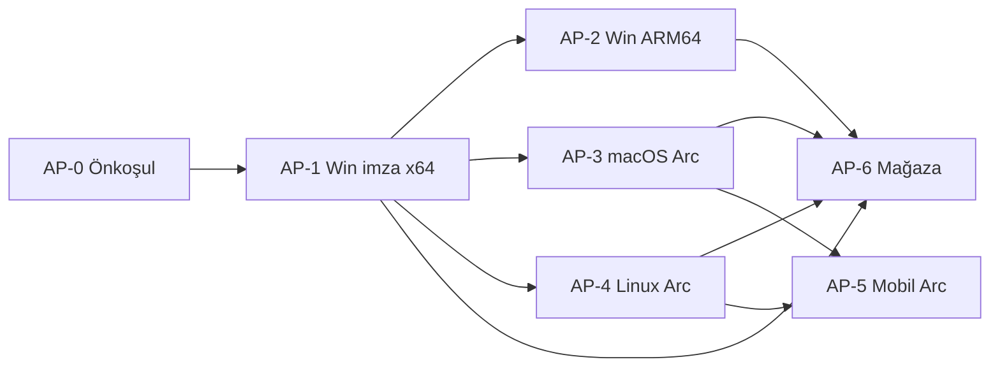

# Lertiva Arc — platform ve sürüm faz planı (henüz yapılmayanlar)

**Bağlam:** Windows x64 NSIS (v1.0.1 GA) ve kurumsal GPO tamam. Bu plan, aşağıdaki **Arc-özel** platform işlerini faz faz kapatır.  
**Üst plan:** [GAP_TO_100_FAZ_PLAN.md](./GAP_TO_100_FAZ_PLAN.md) (G1–G10) · **Release pistleri:** [LERTIVA_ARC_RELEASE_TRACKS.md](./LERTIVA_ARC_RELEASE_TRACKS.md)

| Kod | Konu | Bugün | Hedef faz |
|-----|------|--------|-----------|
| AP-1 | Windows imzalı (EV/OV) | v1.0.1 imzasız | **Faz 1** |
| AP-2 | Windows ARM64 | Yok | **Faz 2** |
| AP-3 | macOS Arc (.app / .dmg) | Yok (Zip macOS CI var) | **Faz 3** |
| AP-4 | Linux Arc (GUI paket) | Yalnızca `cargo check` | **Faz 4** |
| AP-5 | Android / iOS Arc | Yok (Zip okuyucu MVP ayrı) | **Faz 5** |
| AP-6 | Mağaza (Microsoft Store vb.) | Yok | **Faz 6** |



**Paralel çalışma:** AP-2 ile AP-3 başlangıcı (macOS workflow iskeleti) imza hattı yeşil olduktan sonra birlikte yürütülebilir. AP-5 ve AP-6 bilinçli olarak **masaüstü kanalları** (AP-1–4) oturduktan sonra.

---

## AP-0 — Önkoşul (tüm fazlar)

| Alan | Teslim | Doğrulama |
|------|--------|-----------|
| Sürüm tek kaynağı | `apps/lertiva-arc/src-tauri/tauri.conf.json` `version` ↔ tag politikası | `publish-lertiva-arc-stable-tag.sh` |
| CI pistleri | `lertiva-arc-windows.yml` (beta), `lertiva-arc-windows-stable.yml` (tag `v1.0.*`) | Actions yeşil |
| Vitrin | `lertiva-downloads-manifest.json` platform alanları genişletmeye hazır | `refresh-lertiva-downloads-manifest.sh` |
| Kapı JSON şablonu | `lertiva-arc-platform-gate.json` (yeni, faz faz `platforms[]` doldurulur) | `evaluate-*` script (Faz 1 sonunda) |

**İnsan:** Yok (repo-only).

---

## Faz AP-1 — Windows x64 imzalı (EV/OV Authenticode)

**Gap eşlemesi:** G2 · **Hedef sürüm:** `v1.0.2+` (v1.0.0 legacy dokunulmaz, v1.0.1 imzasız kalabilir).

| # | İş | Sahip | Teslim |
|---|-----|--------|--------|
| 1.1 | PFX / EV-OV sertifika | İnsan | GitHub `WINDOWS_CERTIFICATE` + şifre (veya `TAURI_SIGNING_*`) |
| 1.2 | Stable workflow imza | Agent | `lertiva-arc-windows-stable.yml` → `sign-windows-nsis-bundle.ps1` artifact imzalı |
| 1.3 | Beta workflow parity | Agent | `lertiva-arc-windows.yml` aynı imza adımı |
| 1.4 | Tag + release | İnsan/Agent | Annotated tag `v1.0.2`, asset: `Lertiva.Arc_1.0.2_x64-setup.exe` |
| 1.5 | Vitrin + SmartScreen hub | Agent | Manifest `signed: true`; gerçek kurulum PNG (`import-real-installer-screenshots.sh`) |
| 1.6 | Kapı | Agent | `lertiva-windows-signing-gate.json` Arc satırı; `lertiva-ev-ov-configured.flag` |

**Doğrulama:** `bash scripts/verify-madde-m.sh` · `verify-windows-signature.ps1` release exe üzerinde.  
**Bitiş kriteri:** GitHub Release’te imzalı x64 NSIS; vitrin “Lertiva Arc v1.0.2 (Windows, imzalı)” veya eşdeğer etiket.

**Referans:** [MADDE_M_V1_0_1_SIGNING.md](./MADDE_M_V1_0_1_SIGNING.md), [G2_G3_SIRALI_RUNBOOK.md](./G2_G3_SIRALI_RUNBOOK.md) Bölüm A.

---

## Faz AP-2 — Windows ARM64

**Bağımlılık:** AP-1 (imza pipeline kanıtlandı; ARM64 build aynı sertifikayla imzalanır).

| # | İş | Sahip | Teslim |
|---|-----|--------|--------|
| 2.1 | Tauri hedef | Agent | `tauri.conf.json` → NSIS/WiX ARM64 veya ayrı `aarch64-pc-windows-msvc` bundle |
| 2.2 | CI matrix | Agent | `windows-latest` + `windows-11-arm` (veya self-hosted ARM) job |
| 2.3 | libunrar / native deps | Agent | ARM64 cross-compile veya native runner; `UNRAR_EMBEDDED` doğrulama |
| 2.4 | İmza | Agent | Aynı `sign-windows-nsis-bundle.ps1` ARM64 exe |
| 2.5 | Vitrin | Agent | Manifest `windows_arm64.installer_url` |
| 2.6 | QA | İnsan | Fiziksel veya VM ARM64 Windows smoke (Explorer shell opsiyonel) |

**Doğrulama:** Yeni workflow `lertiva-arc-windows-arm64.yml` veya stable matrix; artifact indirilebilir.  
**Bitiş kriteri:** İmzalı `*_arm64-setup.exe` (veya adlandırma standardı dokümante) GitHub Release’te.

**Risk:** GitHub hosted ARM runner erişimi; gerekirse self-hosted worker ([Cloud Agent worker pool](../../README.md) ile aynı model).

---

## Faz AP-3 — macOS Arc (.app / .dmg)

**Gap eşlemesi:** G3 (Apple) · **Referans kopya:** `.github/workflows/lertiva-zip-macos.yml` (Arc için türet).

| # | İş | Sahip | Teslim |
|---|-----|--------|--------|
| 3.1 | Workflow | Agent | `lertiva-arc-macos.yml` — `npm run tauri build -w @lertiva/arc`, `bundles: dmg` |
| 3.2 | RAR / 7z macOS | Agent | Feature bayrakları; sistem `unar`/7z dokümantasyonu ([UNRAR_EMBEDDED.md](../UNRAR_EMBEDDED.md)) |
| 3.3 | Apple Developer | İnsan | `APPLE_*`, app id `com.lertiva.rar` (veya macOS-specific id kararı) |
| 3.4 | Notarize + staple | İnsan/Agent | G3 runbook; gate `lertiva-apple-notarize-configured.flag` |
| 3.5 | KPI (opsiyonel) | Agent | `lertiva-arc-macos-*-kpi.json` vitrin (Zip W34 modeli) |
| 3.6 | Vitrin | Agent | `/urunler/lertiva-arc/` + indirme merkezi macOS satırı |

**Doğrulama:** `verify-madde-w14.sh` genişletme (Arc dmg); Gatekeeper açılış testi (insan).  
**Bitiş kriteri:** Notarize edilmiş dmg public veya authenticated indirme linki; vitrinde macOS Arc görünür.

**Karar (Faz 3 başında):** macOS’ta Explorer entegrasyonu **yok** — ürün metninde “Finder + sürükle-bırak” kapsamı net yazılır.

---

## Faz AP-4 — Linux Arc (GUI paket)

**Bağımlılık:** AP-1 önerilir (marka/imza tutarlılığı); teknik olarak AP-0 yeterli.

| # | İş | Sahip | Teslim |
|---|-----|--------|--------|
| 4.1 | Paket formatı | Karar | **AppImage** (geniş) + isteğe bağlı `.deb` (kurumsal) |
| 4.2 | CI | Agent | `lertiva-arc-linux.yml` — `ubuntu-22.04`, Tauri deps, `bundles appimage` |
| 4.3 | RAR Linux | Agent | Feature off veya `unrar` paket bağımlılığı; vitrin README |
| 4.4 | Desktop entegrasyon | Agent | `.desktop`, MIME (`zip`, `wlrt`, …); Explorer eşdeğeri yok |
| 4.5 | Vitrin / indirme | Agent | Manifest `linux.appimage_url` |
| 4.6 | QA | İnsan | Ubuntu 22.04/24.04 smoke |

**Doğrulama:** `main-pipeline.yml` içinde `cargo check` yerine per-PR optional workflow; release tag `v1.0.x-linux` veya çoklu artifact aynı tag.  
**Bitiş kriteri:** AppImage GitHub Release; en az bir LTS dağıtımda açılış testi PASS.

---

## Faz AP-5 — Android / iOS Arc

**Gap eşlemesi:** G6 · **Strateji:** [G7_DESKTOP_FIRST_PLAY_INTERNAL.md](./G7_DESKTOP_FIRST_PLAY_INTERNAL.md) — **masaüstü AP-1–4 sonrası**.

| # | İş | Sahip | Teslim |
|---|-----|--------|--------|
| 5.0 | Kapsam kararı | Ürün | **Arc Tam** vs **Arc Lite** (aç/görüntüle/çıkart; oluşturma kısıtlı) |
| 5.1 | Kod tabanı | Agent | Tauri v2 mobile veya `apps/mobile` genişletme; paylaşım intent |
| 5.2 | Android | Agent | AAB internal track; W26 API ile uyum |
| 5.3 | iOS | Agent/İnsan | TestFlight **ertelenmiş** (G7); Arc iOS AP-5b alt faz |
| 5.4 | Kapı | Agent | `lertiva-arc-mobile-mvp-gate.json` (yeni) |

**Bağımlılık:** AP-4 (ortak motor davranışı stabil); Zip mobil MVP deneyimi (G6 repo ✅).  
**Bitiş kriteri (AP-5a Android):** Play internal’da “Lertiva Arc” veya “Lertiva Arc Lite” yüklenebilir build.  
**Bitiş kriteri (AP-5b iOS):** TestFlight build (notarize benzeri Apple süreci).

---

## Faz AP-6 — Mağaza (Microsoft Store ve diğer)

**Gap eşlemesi:** G7 · **Bağımlılık:** AP-1 (imzalı x64), AP-2 (Store ARM64 paketi), AP-4 isteğe bağlı (Snap/Flathub ayrı alt hat).

| # | İş | Sahip | Teslim |
|---|-----|--------|--------|
| 6.1 | MSIX / Store paketi | Agent | Tauri `bundles msix` veya `makeappx` pipeline |
| 6.2 | Partner Center | İnsan | Microsoft Developer hesabı, listing, yaş derecelendirme |
| 6.3 | Store imza | İnsan | Store-managed veya bring-your-own (EV ile ilişki) |
| 6.4 | Güncelleme kanalı | Agent | Store vs direct NSIS — vitrinde “Mağaza / Doğrudan indir” ayrımı |
| 6.5 | Diğer mağazalar | Backlog | Mac App Store (AP-3 sonrası), Snap/Flathub (AP-4 sonrası) |
| 6.6 | Kapı | Agent | `lertiva-arc-store-listing-gate.json`; URL `lertiva-store-listing-url.txt` |

**Bitiş kriteri:** Microsoft Store’da (en az **private**/preview) Lertiva Arc listelenmiş; vitrin linki dolu.

---

## Özet tablo — sıra ve çıktılar

| Faz | Ana çıktı | Vitrin / release | İnsan kritik yolu |
|-----|-----------|------------------|-------------------|
| **AP-0** | Gate şablonu, manifest alanları | — | — |
| **AP-1** | v1.0.2 imzalı x64 NSIS | downloads + SmartScreen hub | EV/OV PFX |
| **AP-2** | ARM64 NSIS | manifest `windows_arm64` | ARM64 test cihazı |
| **AP-3** | Notarize dmg | Arc macOS indir | Apple Developer |
| **AP-4** | AppImage (+ deb?) | Arc Linux indir | Linux smoke |
| **AP-5** | Play / TestFlight Arc | mobil bölüm | Play Console, Apple |
| **AP-6** | Store listing | mağaza linki | Partner Center |

---

## Repo maddeleri (agent backlog — sırayla)

1. `docs/qa/ARC_PLATFORM_FAZ_PLAN.md` (bu dosya) + `GAP_PROGRESS.md` linki  
2. AP-1: tag `v1.0.2` + manifest `signed` + gate JSON  
3. AP-2: `lertiva-arc-windows-arm64.yml` + tauri target doc  
4. AP-3: `lertiva-arc-macos.yml` + vitrin i18n macOS Arc  
5. AP-4: `lertiva-arc-linux.yml` + MIME/desktop  
6. AP-5: mobile scope doc + gate  
7. AP-6: msix workflow + store gate  

**Pilot dalga önerisi:** Mevcut Dalga 4 (v1) sonrası **Dalga 5 = AP-1 signoff**, **Dalga 6 = AP-3 macOS pilot**, **Dalga 7 = kurumsal çoklu-OS (AP-4 + GPO Linux notu)**.

---

## İlgili komutlar

```bash
# Imza prep (secret sonrası)
bash scripts/verify-madde-m.sh
bash scripts/publish-lertiva-arc-stable-tag.sh   # version bump → v1.0.2

# Tüm repo gap kapıları
bash scripts/verify-faz-all.sh
bash scripts/verify-product-gap-all.sh
```

**Son güncelleme:** 2026-10-31 — **AP-0 ✅** (`verify-arc-platform-ap0.sh`) · **AP-1 prep ✅** (tauri 1.0.2, runbook) · **AP-1 ship** → EV secret + `agent-arc-ap1-publish.sh`.
