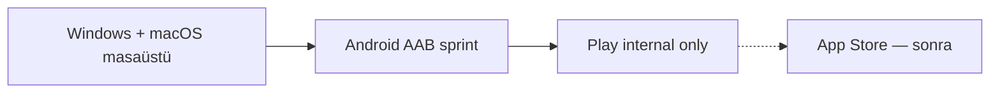

# G7 strateji — önce masaüstü, mağaza yalnızca Play internal

**Onaylı sıra:** Windows + macOS dağıtımı ve KPI/imza olgunlaşır; mobil mağaza **yalnızca Google Play internal testing** ile başlar. **App Store / TestFlight** bilinçli olarak **sonra** (G3 notarize hazır olsa bile öncelik masaüstü).

## Neden?

| Öncelik | Gerekçe |
|---------|---------|
| Windows / macOS | Birincil ürün (Zip + Arc), KPI, imza, kurumsal GPO, vitrin indir |
| Play internal | Düşük riskli okuyucu/MVP (W26); kapalı test kullanıcı listesi |
| App Store | Ayrı build, notarize maliyeti, review — masaüstü GA sonrası |

Listing URL dosyası **boş kalabilir**; repo G7 kapısı (W27/W32/Data safety) yine **geçer**. Ürün adımı: `listing_url_set` yalnızca Play internal açıldığında dolar.

---

## Aşama 1 — Masaüstü (şimdi)

| # | Hedef | Doğrulama / doküman |
|---|--------|---------------------|
| 1 | Windows P0 + resmi KPI | G1 · `lertiva-zip-p0-gate.json` |
| 2 | Windows dev/EV imza | G2 · [MADDE_G2_EV_OV.md](./MADDE_G2_EV_OV.md) |
| 3 | macOS dmg CI + resmi zip KPI | G3 · W34 vitrin |
| 4 | macOS notarize (isteğe bağlı, masaüstü) | G3 · [WINLRTZIP_MACOS_NOTARIZE.md](./WINLRTZIP_MACOS_NOTARIZE.md) |
| 5 | İndir / vitrin | winlrt.com.tr · GitHub Releases |

```bash
bash scripts/verify-faz-g1.sh
bash scripts/verify-faz-g2.sh
bash scripts/verify-faz-g3.sh
```

**Bitiş kriteri (masaüstü):** Windows imzalı installer CI yeşil, macOS resmi KPI vitrinde, kurumsal paket hazır (G5 repo).

---

## Aşama 2 — Mobil okuyucu (repo hazır, binary sonra)

Repo: W26 + W36 ([apps/mobile/README.md](../../apps/mobile/README.md)).

| # | İş | Not |
|---|-----|-----|
| 1 | `mobile-inspect` / capabilities smoke | Zaten CI |
| 2 | Android AAB (Tauri mobile veya ince kabuk) | **Ayrı sprint** |
| 3 | iOS | **Bu stratejide ertelenir** |

---

## Aşama 3 — Yalnızca Google Play internal

**App Store Connect adımı yok** bu fazda.

1. [Google Play Console](https://play.google.com/console) → uygulama **Lertiva Zip** · `com.lertiva.zip`
2. Store listing + [Data safety](./WINLRTZIP_STORE_DATA_SAFETY.md) (şablondan)
3. **Release → Testing → Internal testing** → AAB yükle → yayınla
4. Internal testing sayfa URL’sini kopyala (veya `https://play.google.com/apps/testing/com.lertiva.zip`)

Repoya:

```bash
printf '%s\n' 'https://play.google.com/apps/testing/com.lertiva.zip' \
  > apps/web/public/benchmark/samples/lertiva-store-listing-url.txt

bash scripts/evaluate-lertiva-store-listing-gate.sh
git add apps/web/public/benchmark/samples/lertiva-store-listing-url.txt \
        apps/web/public/benchmark/samples/lertiva-zip-store-listing-gate.json
git commit -m "chore(g7): Play internal listing URL"
```

5. Vitrin deploy → benchmark **Mağaza listing (G7)** kartında URL görünür.

---

## Aşama 4 — Sonra (bilinçli erteleme)

- App Store / TestFlight
- Play open / production track
- Mağaza inceleme (production)

---

## Özet



**Listing URL:** yalnızca **P** tamamlanınca doldurulur; masaüstü odakta uyarı (`listing URL yok`) **normaldir**.
