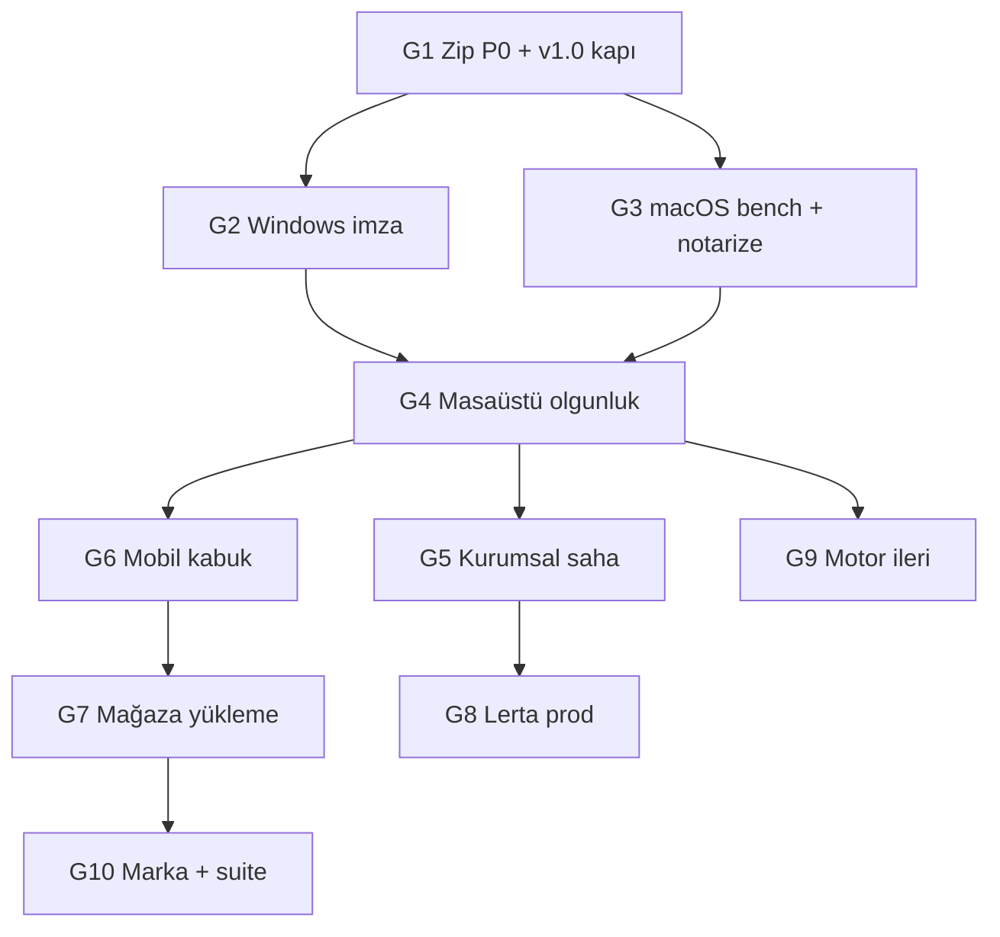

# Gap → %100 — faz faz plan (gerçekçi ürün olgunluğu)

**Bağlam:** Post-v3 **W0–W32** repo maddeleri tamam; bu doküman **henüz yapılmayan veya ~%0’a yakın** işleri sırayla kapatır.  
**Ölçü:** Vitrin durumu, `lertiva-zip-p0-gate.json`, imza/mağaza/Lerta canlı, [WINLRTRAR_PLAN.md](../WINLRTRAR_PLAN.md) / [WINLRTZIP_PLAN.md](../WINLRTZIP_PLAN.md) açık maddeler.

---

## Faz G1 — Zip P0×3 + resmi sürüm kapısı (~%45 → ~%60 ürün)

| Gap (bugün) | Hedef | Teslim |
|-------------|--------|--------|
| Hız P0 ❌, `all_pass: false` | Üçü ✅, vitrin JSON yeşil | Windows resmi `bench-windows` / artifact → `import-windows-zip-kpi-to-vitrin.sh` |
| Zip v1.0 GA yok, Beta 0.1.0 | **v1.0.0 kapı tanımı** (W33 aday) | `docs/qa/MADDE_W33_*`, `lertiva-zip-v1-gate.json`, vitrin “Beta” → “v1.0” koşullu |
| macOS placeholder KPI | En az **1 gerçek** macOS zip_kpi satırı | Mac agent veya `lertiva-zip-macos` artifact import |

**Doğrulama:** `evaluate-lertiva-zip-p0-gate.sh` → `all_pass: true`; `verify-madde-w16.sh` + yeni W33 script.  
**Bağımlılık:** Yok (öncelik 1).  
**Tahmini madde:** W33 (P0+v1 kapı), W34 (macOS KPI resmi).

---

## Faz G2 — Windows güven (Authenticode / SmartScreen) (~%0 → ~%70 imza hattı)

| Gap | Hedef | Teslim |
|-----|--------|--------|
| Authenticode ~%0, vitrin SmartScreen **mock** | İmzalı NSIS/exe (Arc + Zip beta track) | `TAURI_SIGNING_*` GitHub secrets; `lertiva-arc-windows` / `lertiva-zip-windows` yeşil imzalı artifact |
| SmartScreen güven ~%0 | Gerçek kurulum ekranı vitrinde | `import-real-installer-screenshots.sh` gerçek PNG; mock kaldır |

**Doğrulama:** [MADDE_H_IMZA.md](./MADDE_H_IMZA.md), [MADDE_M_V1_0_1_SIGNING.md](./MADDE_M_V1_0_1_SIGNING.md); `verify-windows-signature.ps1` örnek exe.  
**Bağımlılık:** G1 isteğe bağlı (v1.0 imzalı tek release olabilir).  
**İnsan:** Sertifika satın alma / EV süreci.

---

## Faz G3 — macOS olgunluk (~%35 → ~%65)

| Gap | Hedef | Teslim |
|-----|--------|--------|
| Notarization ~%0 | `APPLE_*` + staple | [WINLRTZIP_MACOS_NOTARIZE.md](./WINLRTZIP_MACOS_NOTARIZE.md) checklist ✅ |
| Gerçek macOS bench ~%0 | Vitrin disclaimer kalkar | `lertiva-zip-macos-*-kpi.json` `source: macos-official-ci` |

**Doğrulama:** `verify-madde-w14.sh` genişletme; dmg imzalı indirilebilir link (opsiyonel vitrin).  
**Bağımlılık:** G2 ile paralel (Apple hesabı).

---

## Faz G4 — Masaüstü “rakip seviyesi” UX/perf (~%50 → ~%75)

| Ürün | Gap | Hedef |
|------|-----|--------|
| **Arc** | WinRAR seviyesi UX/perf ~%50 | Geçiş sihirbazı polish, kısayol haritası, iş kuyruğu stabilitesi, perf hedefleri ([WINLRTRAR_PLAN](../WINLRTRAR_PLAN.md) açık UX maddeleri) |
| **Zip** | WinZip parity | Explorer I1/I2 saha, migration sihirbazı gerçek pilot, UI tutarlılık |

**Teslim:** QA kopyaları + en az 1 dış kullanıcı oturumu (KOBİ); vitrin pilot wave 5+.  
**Bağımlılık:** G1–G3 (stabil sürüm kanalı).  
**Repo maddeleri:** Dalga 5 pilot, Zip explorer signoff gerçek tag.

---

## Faz G5 — Kurumsal saha (~%25 → ~%60)

| Gap | Hedef | Teslim |
|-----|--------|--------|
| Kurumsal Zip “canlı müşteri” düşük | 1 imzalı kurumsal signoff (banka **veya** sendika) | [KURUMSAL_PILOT_SIGNOFF.md](./KURUMSAL_PILOT_SIGNOFF.md) doldurulmuş |
| Arc dalga 3 agent ≠ saha | GPO + audit gerçek AD ortamı | IT preflight log + GPO import kanıtı |

**Doğrulama:** `verify-lertiva-zip-corporate-prereqs.sh` + insan signoff PDF/MD.  
**Bağımlılık:** G4 (kurulum deneyimi).

---

## Faz G6 — Mobil (~%15 → ~%40)

| Gap | Hedef | Teslim |
|-----|--------|--------|
| Android/iOS uygulama ~%0 | **Okuyucu MVP** (W26 API tüketir) | Minimal Tauri mobile veya Flutter/React Native PoC; `mobile-inspect` + paylaşım intent |
| Mağaza öncesi | Internal TestFlight / Play internal | Bundle id `com.lertiva.zip` sabit |

**Doğrulama:** W26 genişletme + `verify-madde-w36` (tanımlanacak).  
**Bağımlılık:** G1 (API stabil), G2 (imza mobil için).

---

## Faz G7 — Mağaza gerçek yükleme (~%25 → ~%100 checklist, ~%50 mağaza)

| Gap | Hedef | Teslim |
|-----|--------|--------|
| Play/App Store yükleme ~%0 | İlk **internal** → **closed beta** listing | Data safety + App Store privacy doldurulmuş ([WINLRTZIP_STORE_DATA_SAFETY.md](./WINLRTZIP_STORE_DATA_SAFETY.md)) |
| W27/W32 repo kapısı | Mağaza **inceleme** gönderildi | Store Console screenshot + vitrin “Mağaza: incelemede” |

**Doğrulama:** W32 `store_pilot_gate` + insan: listing URL.  
**Bağımlılık:** G6 (binary), G3 (iOS), G2 (Windows opsiyonel sideload).

---

## Faz G8 — Lerta üretim (~%25 canlı → ~%80 entegrasyon)

| Gap | Hedef | Teslim |
|-----|--------|--------|
| Canlı API ~%15–25 / prod slug | `live_submit_allowed: true` (kontrollü) | Backend `/integrations/lertiva-zip/*` onayı; `LERTA_API_BEARER` prod secret |
| Dry-run only | 1 canlı metadata kaydı (içerik cihazda) | IT signoff + audit log |

**Doğrulama:** W31 genişletme; staging_gate_pass + prod smoke (ayrı env).  
**Bağımlılık:** G5 (KVKK/kurumsal onay). **İnsan:** Lerta backend ekibi.

---

## Faz G9 — Motor ileri (Arc plan ~%0–20 → ~%50 seçili MVP)

| Gap ([WINLRTRAR_PLAN](../WINLRTRAR_PLAN.md)) | Öncelik | Teslim |
|-----------------------------------------------|---------|--------|
| Solid + deduplication | Orta | Spike + bench satırı |
| Akışlı açma (tek dosya önizleme) | Yüksek | API + Arc UI |
| Kısmi kurtarma | Düşük | R&D madde |
| Tam codec matrisi | Orta | Doküman + 7-Zip/WinRAR satır genişletme |

**Doğrulama:** Yeni `MADDE_Q*` (Post-v4 Arc motor) veya Post-v2 devam maddeleri.  
**Bağımlılık:** G1 KPI yeşil (perf regresyon).

---

## Faz G10 — Marka + suite (~%25 → tam tur 4 + vizyon)

| Gap | Hedef | Teslim |
|-----|--------|--------|
| Domain/repo/tag `winlrt-*` | `lertiva-*` release politikası (veya bilinçli dual) | Tur 4 runbook |
| PDF / imza / sertifika suite ~%0 | Faz 0 plan + vitrin placeholder | [PRODUCT_ROADMAP.md](../PRODUCT_ROADMAP.md) madde 4 kickoff |

**Bağımlılık:** G7–G8 (dış yüzey stabil).

---

## Özet tablo — bugün → faz sonu (ürün ağırlıklı)

| Alan | Bugün (≈) | Faz | Hedef (≈) |
|------|-----------|-----|-----------|
| Motor+CLI+bench+CI (ileri hariç) | 75% | G9 | 85% (+ seçili ileri) |
| Arc Windows masaüstü | 65% | G2,G4 | 80% |
| Zip P0×3 | **100%** (Windows resmi) | **G1** | W34 macOS |
| Zip Windows beta → v1 | 55% | **G1,G2** | 85% |
| macOS | 35% | **G3** | 65% |
| Kurumsal saha | 25% | **G5** | 60% |
| Mobil uygulama | 0% | **G6** | 40% (MVP) |
| Mağaza gerçek | 0% | **G7** | 50% (beta listing) |
| Lerta canlı | 15–25% | **G8** | 80% |
| Authenticode/SmartScreen | **~70%** (dev CI ✅) | **G2** | EV/OV + vitrin PNG |
| Marka/suite | 25% | **G10** | 70% |

---

## Agent sırası (önerilen)

1. **G1** — P0 hız + W33 v1 kapı + deploy (tek odak).  
2. **G2** — imza secrets + gerçek SmartScreen vitrin.  
3. **G3** — macOS KPI + notarize.  
4. Paralel izin verilirse: **G5** kurumsal oturum şablonu, **G8** Lerta IT checklist.

Her faz: `verify-madde-*` veya yeni `verify-faz-gN.sh` → `main` → `post-phase-deploy.sh`.
